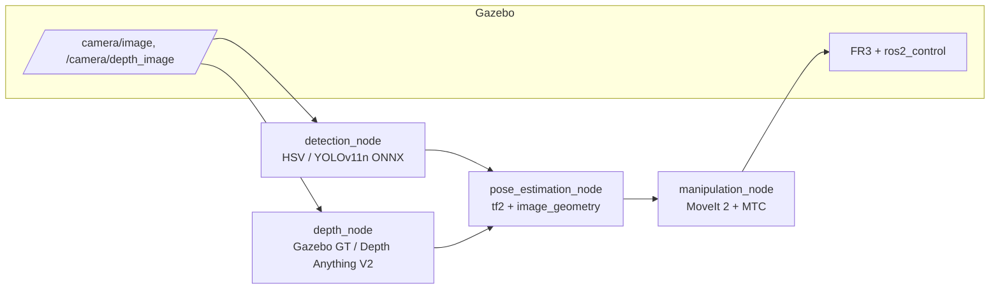

# PerceptionBOT

ROS 2 vision-guided multi-object sorting on a Franka FR3 in Gazebo Harmonic.

A YOLOv11n + Depth Anything V2 perception stack feeds 6-DoF object poses into
a MoveIt 2 Task Constructor pick-and-place pipeline that color-routes objects
to matching bins.



## Stack

- **ROS 2 Jazzy + Gazebo Harmonic** on Ubuntu 24.04
- **MoveIt 2** + **MoveIt Task Constructor**
- **ONNX Runtime** (CUDA EP, CPU fallback)
- **OpenCV 4** (HSV color detector + image utilities)
- C++17 throughout; Python only for launch + helper scripts
- `franka_description` consumed as a git submodule

## Repository layout

| Package | Purpose |
| --- | --- |
| `perception_bot_msgs`        | Custom messages + `SortObjects` action |
| `perception_bot_description` | URDF wrapper, Gazebo world (table, bins, camera) |
| `perception_bot_perception`  | `detection_node`, `depth_node`, `pose_estimation_node` |
| `perception_bot_manipulation`| MoveIt config + MTC sort planner + `SortObjects` action server |
| `perception_bot_bringup`     | Composed launch files + RViz |

## Quick start

```bash
# Clone with submodules
git clone --recurse-submodules <this repo>
cd perceptionBOT

# Install ROS 2 Jazzy + Gazebo Harmonic + MoveIt 2
bash scripts/install_deps.sh

# (Optional but recommended) install ONNX Runtime so the YOLOv11 and
# Depth Anything V2 paths build:
bash scripts/install_onnxruntime.sh

# (Optional) download model weights
python3 scripts/download_models.py

# Build
colcon build --symlink-install

# End-to-end demo (Gazebo + MoveIt + perception + manipulation + RViz)
bash scripts/run_demo.sh
```

`scripts/run_demo.sh` waits for the controllers and action servers to come
up, spawns a few colored objects with `scripts/spawn_objects.py`, records a
rosbag of `/perception/*` topics, and dispatches a `SortObjects` action goal.

## Architecture notes

### Detection — HSV by default, YOLOv11n optional

The Gazebo objects are red/blue/green geometric primitives. A pretrained
COCO YOLOv11 won't recognize a class called `red_cube`, so the default
detection backend is HSV thresholding + contour bbox + aspect-ratio cube vs
cylinder labelling — the standard sim-sorting solution. The YOLOv11n ONNX
inference path (CUDA EP, full preprocess/NMS, COCO classes) is implemented
and selectable via `backend:=yolo` for general-object detection. It is built
only when ONNX Runtime is found at `/opt/onnxruntime`.

### Depth — Gazebo GT default, Depth Anything V2 optional

`SortObjects.action` takes a `bool use_estimated_depth`. The default is
`false`, in which case `pose_estimation_node` consumes Gazebo's
`/camera/depth_image`. With `true`, it consumes `/perception/depth_estimated`
produced by `depth_node`, which runs Depth Anything V2 ViT-S in ONNX and is
metrically aligned to Gazebo depth on the first frame (median ratio fit).

### Manipulation — MTC pipeline

For each detected object, the planner builds an MTC `Task`:

```
current → open_hand → connect → approach → grasp_pose+IK → close_hand →
attach → lift → connect → place_pose+IK → open_hand → detach → retreat → home
```

Color routing: `red_*` → `bin_red`, `blue_*` → `bin_blue`, `green_*` → `bin_green`.

## Running individual pieces

```bash
# Just Gazebo + the FR3 + controllers
ros2 launch perception_bot_bringup gazebo.launch.py

# MoveIt move_group only (assumes Gazebo is up and joint_states are flowing)
ros2 launch perception_bot_manipulation move_group.launch.py

# Send a manual sort goal
ros2 action send_goal /sort_objects perception_bot_msgs/action/SortObjects \
  '{use_estimated_depth: false, max_objects: 0}'
```

## Docker

```bash
docker compose -f docker/docker-compose.yml build
xhost +local:root  # so the GUIs can connect
docker compose -f docker/docker-compose.yml up
```

Requires the NVIDIA container runtime (`runtime: nvidia` in the compose
file) for GPU-accelerated ONNX Runtime and Gazebo rendering.

## CI

GitHub Actions builds the workspace and runs `colcon test` on every push to
`main` and on every PR (`.github/workflows/ci.yml`). The CI installs the
CPU build of ONNX Runtime (no GPU drivers in the runner) and skips Gazebo-
dependent tests.

## License

Apache-2.0. See per-package `LICENSE` files.

## Author

Wycliffe Oletiai (Wicky) — M.Sc. AI student, Brandenburg University of
Technology Cottbus; Master's-thesis researcher at Fraunhofer ISE Freiburg.
